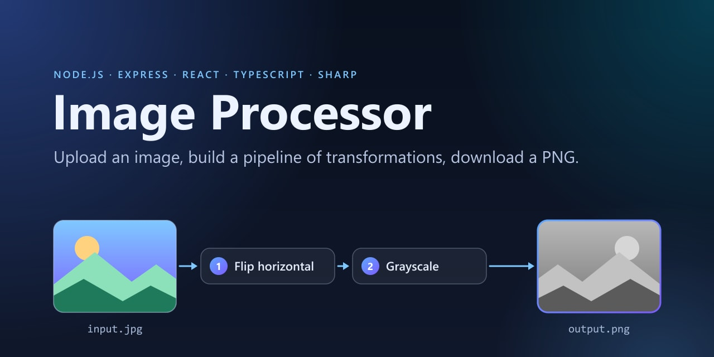

<p align="center">
  
</p>

# Image Processing Project

A web-based image processor built with Node.js, Express, React, and TypeScript.

## What it does

Users upload an image, build an ordered pipeline of transformations, and receive a processed PNG download.

Supported operations:

- Flip horizontal
- Flip vertical
- Convert to grayscale
- Rotate left
- Rotate right

## Project Structure

- `docs/architecture.md` - architecture write-up with diagrams and rationale
- `docs/openapi.yaml` - API specification
- `server/` - Express API implementation
- `client/` - React frontend

## Development

Install dependencies from the repository root:

```bash
npm install
```

Run the frontend and backend together:

```bash
npm run dev
```

Build both packages:

```bash
npm run build
```

Start the backend in production mode:

```bash
npm start
```

## API

The primary endpoint is `POST /api/transform` and expects `multipart/form-data` with:

- `image`: file upload
- `operations`: JSON string describing the ordered pipeline

## License

[MIT](LICENSE) © 2026 Rupeshwar Rao
