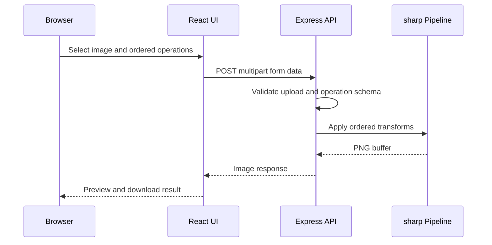
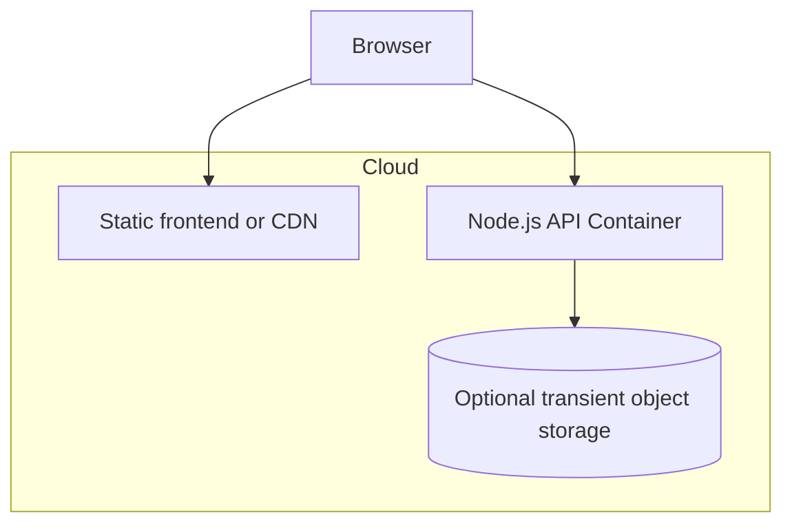

# Image Processor Architecture

## 1. High-Level Overview

This system is a web-based image transformation service with two primary parts:

- A React single-page application for the user interface.
- A Node.js/Express API that accepts an uploaded image, applies an ordered set of transformations, and returns the resulting image as a download.

The service is intentionally stateless. The API processes the image in memory, returns the transformed file immediately, and does not keep a permanent copy of either the source or the output image.


## 2. Component Model

### Frontend

The frontend is a React app that allows the caller to:

- Upload an image.
- Build an ordered transformation pipeline.
- Choose flip direction, grayscale, and rotation direction.
- Submit the image and receive the transformed result.
- Preview and download the returned file.

### Backend

The backend is a Node.js Express service that exposes a small REST API:

- `GET /api/health` for liveness checks.
- `POST /api/transform` for image processing.

The backend uses `multer` with in-memory storage so uploaded files are never persisted to disk by default. The transformation logic is implemented with `sharp`, which performs the image operations efficiently in native code.

### Transformation Engine

The processing layer is organized as a small strategy-style pipeline:

- Each supported operation is represented as a typed request object.
- The processing service walks the requested operations in order.
- Each operation maps to one pure transformation step on a `sharp` pipeline.

This keeps the controller thin and makes the business logic easy to test.



## 3. Details Not Easily Shown in Diagrams

The service returns PNG output consistently. That choice simplifies the client, avoids format negotiation, and keeps the API predictable for grading and demo purposes.

The system assumes raster image inputs. SVG and other supported image types can still be accepted by the API and rasterized into PNG on output, but the service is not positioned as a full image editor. It is a deterministic transformation pipeline for a defined operation set.

The service does not store source or result images permanently. That reduces privacy risk and means the architecture scales horizontally without shared state. If temporary persistence is needed in a cloud deployment, it should be isolated to a short-lived object store with automatic expiration.

## 4. Build, Deployment, and Packaging

### Build

- Frontend: `vite build` produces a static site in `client/dist`.
- Backend: `tsc` compiles the Express service to `server/dist`.

### Local Development

The repository is set up as an npm workspace so the frontend and backend can be run together during development.

- Frontend dev server: Vite on port 5173.
- Backend API: Express on port 3000.
- Vite proxies `/api` requests to the backend.

### Cloud Deployment

A cloud-hosted deployment can use either of these patterns:

1. Single container deployment where the backend serves the built frontend assets.
2. Split deployment where the frontend is hosted on a CDN/static host and the API is hosted separately.

For this assignment, the code supports both, but the recommended deployment is a single web app container for simplicity.



## 5. Communication Protocols

- Browser to frontend: HTTPS.
- Frontend to backend: HTTPS using REST over HTTP.
- Upload payload: `multipart/form-data`.
- Response payload: PNG image bytes with `Content-Disposition: attachment`.
- Health checks: JSON over HTTP.

No internal message broker is required because the processing is fast enough to run synchronously in the request path.

## 6. Architecture Justification

This architecture is a good fit because the assignment calls for a web-based image processor with a small, fixed set of operations and a fast turnaround time.

- REST is appropriate because the main action is a single command-style request: upload an image and receive a transformed result.
- In-memory processing is sufficient because the operations are quick and the service should not retain user files.
- React is a good fit for an ordered pipeline editor with previews and file download handling.
- `sharp` is the right backend primitive because it is fast, mature, and designed for image transforms.
- Stateless deployment makes cloud hosting easier and safer.

## 7. API Specification from the Client Perspective

The detailed contract is captured in [openapi.yaml](openapi.yaml). The key endpoint is:

### `POST /api/transform`

Request:

- Content type: `multipart/form-data`
- Field `image`: the uploaded source image
- Field `operations`: JSON array of ordered operations

Supported operation shapes:

- `{ "type": "flip", "direction": "horizontal" }`
- `{ "type": "flip", "direction": "vertical" }`
- `{ "type": "grayscale" }`
- `{ "type": "rotate", "direction": "left" }`
- `{ "type": "rotate", "direction": "right" }`

Response:

- `200 OK`
- PNG image bytes
- `Content-Disposition` header suggests a download filename

### Sample Request

```bash
curl -X POST http://localhost:3000/api/transform \
  -F 'image=@sample.jpg' \
  -F 'operations=[{"type":"flip","direction":"horizontal"},{"type":"rotate","direction":"left"}]' \
  --output result.png
```

### Sample JavaScript Client

```javascript
const formData = new FormData();
formData.append('image', fileInput.files[0]);
formData.append('operations', JSON.stringify([
  { type: 'flip', direction: 'horizontal' },
  { type: 'rotate', direction: 'left' }
]));

const response = await fetch('/api/transform', {
  method: 'POST',
  body: formData
});

if (!response.ok) {
  throw new Error(await response.text());
}

const blob = await response.blob();
const url = URL.createObjectURL(blob);
window.location.href = url;
```

## 8. Implementation Details and Design Patterns

The implementation uses a few simple patterns intentionally:

- Strategy pattern: each image operation is a distinct transformation step.
- Pipeline pattern: operations are composed in caller-defined order.
- Controller/service separation: request parsing is kept separate from transformation logic.
- Stateless request handling: no user session state is required.

The key service code lives in `server/src/services/imageProcessor.ts`, while the request contract is defined in `server/src/models/transform.ts`. The React pipeline editor is in `client/src/App.tsx` and `client/src/components/OperationBuilder.tsx`.

## 9. Operational Notes

- Maximum upload size is limited to 12 MB in the API.
- Unsupported or malformed uploads return clear HTTP errors.
- The service should be deployed behind HTTPS in any public environment.
- If persistence is added later, it should use short-lived object storage and expiration policies rather than local disk.
